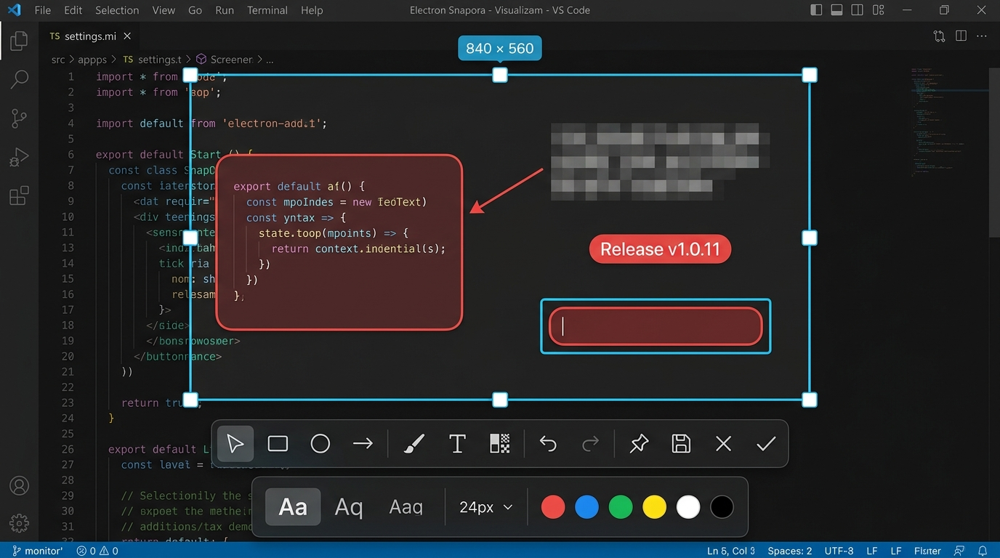

# electron-snapora — Electron 截图插件与标注工具

[](https://www.npmjs.com/package/electron-snapora)
[](https://www.npmjs.com/package/electron-snapora)
[](https://www.npmjs.com/package/electron-snapora)
[](https://github.com/electron-tools/electron-snapora/blob/main/LICENSE)
[](https://github.com/electron-tools/electron-snapora)
[](https://github.com/electron-tools/electron-snapora)
[](https://www.electronjs.org)
[](https://nodejs.org)
[](https://www.typescriptlang.org/)
[](https://github.com/electron-tools/electron-snapora)
[](https://github.com/electron-tools/electron-snapora/actions)

[English](https://github.com/electron-tools/electron-snapora/blob/main/README.md) | 简体中文 | [日本語](https://github.com/electron-tools/electron-snapora/blob/main/README.ja.md) | [한국어](https://github.com/electron-tools/electron-snapora/blob/main/README.ko.md) | [Español](https://github.com/electron-tools/electron-snapora/blob/main/README.es.md)

一个开箱即用、易于集成的 Electron 屏幕截图插件。通过一步初始化和安全的 Preload IPC，提供区域框选截屏、交互式标注编辑、剪贴板复制、PNG 导出以及贴图置顶图钉窗口等完整能力。

<p align="center">
  
</p>

## 功能特性

- **跨平台屏幕截取**：支持显示器与光标定位截屏。
- **交互式选区覆盖层**：支持自由拖拽框选、8 方向尺寸调整与坐标指示。
- **丰富的上下文标注预设**：矩形、椭圆、箭头、画笔涂鸦、文字（普通/背景色块/描边预设）、强度可调马赛克和全屏平铺水印。
- **流畅的操作体验**：在标注工具激活状态下，可直接拖动已有标注调整位置，无需来回切换工具；点击空白区域继续绘制。
- **输出与贴图**：一键复制到剪贴板、原生保存 PNG 文件，以及创建置顶贴图小窗。
- **等比缩放贴图小窗**：贴图窗口置顶显示、支持自由等比拖拽缩放、右键菜单快捷操作。
- **现代工程支持**：原生 TypeScript 类型，同时支持 ESM 和 CommonJS 规范。
- **零原生扩展依赖**：默认不依赖 C++ 原生模块（0 Native Addons），无需额外 node-gyp 编译。

代码仓库：[github.com/electron-tools/electron-snapora](https://github.com/electron-tools/electron-snapora)  
技术支持：[GitHub Issues](https://github.com/electron-tools/electron-snapora/issues) · [@novratools on X](https://x.com/novratools)  
商标政策：[TRADEMARKS.md](https://github.com/electron-tools/electron-snapora/blob/main/TRADEMARKS.md)

## 支持与问题反馈

如果遇到问题或行为不及预期，请先检索 [已有 Issues](https://github.com/electron-tools/electron-snapora/issues)。若未找到匹配项，请提交 [新的 GitHub Issue](https://github.com/electron-tools/electron-snapora/issues/new) 或在 X 上联系 [@novratools](https://x.com/novratools)。

有效的 Bug 报告建议包含：

- `electron-snapora`、Electron、Node.js 版本以及操作系统环境；
- 最小复现步骤或最小复现工程；
- 预期行为与实际表现；
- 脱敏后的相关错误日志、截图或录屏。

涉及安全或隐私的问题时，请勿在公开 Issue 中包含凭证或敏感数据。

## 快速上手

**最低 Electron 版本：** Electron 42。同时要求 Node.js 20 或更高版本。

### 1. 安装依赖

```bash
npm install electron-snapora
```

如果宿主工程尚未安装 Electron：

```bash
npm install --save-dev electron
```

请确保将本包保存在宿主工程生产依赖 `dependencies` 中，打包后的应用程序运行时需要加载其中的 UI 界面与 Preload 脚本。

### 2. 主进程初始化

使用 `setupElectronSnapora()` 一键创建截图管理器、注册安全 IPC，并为窗口提供开箱即用的 Preload 路径：

```ts
import { app, BrowserWindow, ipcMain } from 'electron';
import { setupElectronSnapora } from 'electron-snapora/main';

app.whenReady().then(() => {
  const snapora = setupElectronSnapora({ ipcMain });
  const mainWindow = new BrowserWindow({
    webPreferences: {
      preload: snapora.preloadPath,
      contextIsolation: true,
      sandbox: true,
    },
  });

  mainWindow.loadFile('index.html');
  app.once('before-quit', snapora.unregister);
});
```

打包 Electron 主进程时，请将 `electron-snapora` 设为外部依赖（external），确保其自带的 HTML、CSS 和 Preload 资源与库入口保持在同级目录。详见 [构建与打包配置](#构建与打包配置)。

### 3. 渲染进程调用

在渲染进程中直接调用注入的 API：

```ts
const result = await window.electronSnapora.capture({ display: 'cursor' });

if (result.status === 'completed') {
  // 返回生成的 PNG 二进制数据、选区几何信息与输出方式
  console.log(result.data, result.bounds, result.output);
}
```

截图覆盖层允许用户框选区域，绘制矩形、椭圆、箭头、画笔、文字、马赛克或平铺水印，随后复制、保存或固定置顶 PNG。按 `Escape` 可取消截图。返回值结构始终为 `completed`、`cancelled` 或 `failed`，调用方无需使用异常捕获即可平滑处理用户常规操作。

从同一渲染进程取消正在进行的截图任务：

```ts
await window.electronSnapora.cancel();
```

如需 TypeScript 类型提示，可在宿主工程的类型定义文件中声明一次：

```ts
import type { ScreenshotRendererApi } from 'electron-snapora/types';

declare global {
  interface Window {
    electronSnapora: ScreenshotRendererApi;
  }
}
```

## 已有 Preload 脚本的应用集成

如果宿主工程已有自己的 Preload 脚本，可忽略 `snapora.preloadPath`，直接在自己的 Preload 构建中暴露 API：

```ts
import { contextBridge, ipcRenderer } from 'electron';
import { exposeScreenshotApi } from 'electron-snapora/preload';

exposeScreenshotApi({ contextBridge, ipcRenderer });
```

开启沙箱的 Preload 脚本无法在运行时动态加载未打包的 npm 模块，因此已有 Preload 需参与打包。未配置独立 Preload 的工程直接使用快速开始提供的 `snapora.preloadPath` 即可。

## 自定义页面来源与安全校验

默认情况下，截图 IPC 出于安全考虑仅接受通过 `BrowserWindow.loadFile()` 加载的顶层页面请求，并严格拒绝所有 iframe 调用。如果宿主应用使用自定义协议或本地开发服务器，可配置明确的白名单验证：

```ts
const snapora = setupElectronSnapora({
  ipcMain,
  validateSender(event) {
    const senderUrl = event.senderFrame?.url;
    if (!senderUrl) return false;

    const url = new URL(senderUrl);
    return (
      url.protocol === 'app:' ||
      (process.env.NODE_ENV === 'development' && url.origin === 'http://localhost:5173')
    );
  },
});
```

Snapora 在主进程还会对截图参数进行二次校验，传入未知或非法参数时会在调用底层截屏前直接返回 `INVALID_REQUEST`。

## 包入口点说明

大多数应用只需引用 `electron-snapora/main` 与注入的 `window.electronSnapora`。其他子入口提供给高级集成场景使用：

```ts
import { setupElectronSnapora } from 'electron-snapora/main';
import { exposeScreenshotApi } from 'electron-snapora/preload';
import { normalizeRect } from 'electron-snapora/core';
```

## 高级配置

### 截图后复制提示

截图完成并复制到剪贴板后的独立提示窗口默认关闭，传入 `showCopyFeedback: true` 开启后显示 3 秒。提示默认采用白底黑字、浅绿色边框和绿色对号，深浅主题下保持一致。文案和颜色可以自定义：

```ts
await window.electronSnapora.capture({
  display: 'cursor',
  showCopyFeedback: true,
  messages: { copied: '已复制到剪贴板' },
  theme: {
    copyFeedbackBackground: '#ffffff',
    copyFeedbackForeground: '#111111',
    copyFeedbackBorderColor: '#dff3eb',
    copyFeedbackIconColor: '#20b88a',
    copyFeedbackIconBackground: '#e4f8ef',
  },
});
```

### 主题与国际化本地化

截图层默认采用英文界面（`en-US`）与深色工具栏。内置语言依次为英语（`en-US`）、简体中文（`zh-CN`）、日语（`ja-JP`）、韩语（`ko-KR`）和西班牙语（`es-ES`），资源集中在 `src/i18n`。调用时可切换语言、自定义文案以及语义化主题色：

```ts
await window.electronSnapora.capture({
  locale: 'zh-CN',
  showCopyFeedback: true,
  messages: {
    confirm: '复制到聊天框',
    copied: '截图已复制',
    copy: '复制',
    save: '保存',
    close: '关闭',
  },
  theme: {
    mode: 'light',
    accentColor: '#6750a4',
    accentForegroundColor: '#ffffff',
    toolbarBackground: 'rgb(250 250 250 / 96%)',
    toolbarForeground: '#1d1b20',
    tooltipBackground: '#27272a',
    warningColor: '#f59e0b',
    copyFeedbackBackground: '#ffffff',
    copyFeedbackForeground: '#111111',
    copyFeedbackBorderColor: '#dff3eb',
    copyFeedbackIconColor: '#20b88a',
    copyFeedbackIconBackground: '#e4f8ef',
  },
});
```

### 宿主策略注入

如果应用需要接入自定义截图源、特殊存储策略或覆盖层管理，可直接传入自定义适配器：

```ts
const snapora = setupElectronSnapora({
  ipcMain,
  managerOptions: {
    captureAdapter: myCaptureAdapter,
    outputAdapter: myOutputAdapter,
    createOverlay: (display) => myOverlayFactory.create(display),
    overlayReadyTimeoutMs: 15_000,
  },
});
```

### 资源上限限制

可针对不同宿主应用调低安全防护阈值：

```ts
const snapora = setupElectronSnapora({
  ipcMain,
  managerOptions: {
    resourceLimits: {
      maxCapturePixels: 32 * 1024 * 1024,
      maxCaptureDataUrlBytes: 96 * 1024 * 1024,
      maxOutputBytes: 32 * 1024 * 1024,
    },
  },
});
```

## 构建与打包配置

请将 `electron-snapora` 放在应用生产依赖 `dependencies` 中，并在构建主进程时将其排除在 bundle 外（externalize）。

### electron-vite 配置示例

```ts
export default defineConfig({
  main: {
    build: {
      rollupOptions: {
        external: [/^electron-snapora(?:\/.*)?$/],
      },
    },
  },
});
```

### Webpack 配置示例

```js
module.exports = {
  target: 'electron-main',
  externals: {
    'electron-snapora/main': 'commonjs electron-snapora/main',
  },
};
```

### electron-builder 配置

`electron-builder` 可将本依赖打包至 ASAR 内部，HTML/CSS/JS 资源无需配置 `asarUnpack`。

### Electron Forge 配置

使用 Electron Forge 时保持依赖在 `dependencies` 中，并在 Vite / Webpack 主进程配置中添加上述 external 规则。若配合 pnpm，建议开启 hoisted 扁平依赖结构。

## 支持基线与平台特性

| 操作系统环境                                     | 状态                               |
| ------------------------------------------------ | ---------------------------------- |
| Windows 11 x64, Electron 42.8/43.3               | 已通过全量自动化与手动验证         |
| Windows ARM64                                    | 等待硬件实测                       |
| macOS (Retina 屏与签名应用)                      | 代码与单测已就绪，等待正式签名验证 |
| Linux X11 / XWayland / native Wayland / PipeWire | 处于适配中                         |

### macOS 权限配置

macOS 10.15 及以上需要屏幕录制权限。在应用首次发起截图请求时系统会弹出原生权限授权弹窗。若用户此前拒绝过，Snapora 会自动引导跳转至“系统设置 → 隐私与安全性 → 屏幕录制”并返回 `PERMISSION_DENIED`。

在打包配置（如 electron-builder）中添加权限用途说明：

```json
{
  "build": {
    "mac": {
      "hardenedRuntime": true,
      "extendInfo": {
        "NSScreenCaptureUsageDescription": "用于捕获选定的屏幕区域并进行标注分享。"
      }
    }
  }
}
```

### macOS 快捷键与宿主窗口保护

唤起截图的全局快捷键由宿主注册；进入截图层后，Escape、R（矩形）、T（文字）等按键由 Snapora 处理。在 macOS 上，Snapora 显示截图层时会恢复窗口的可聚焦属性，并请求应用、窗口和页面获得焦点。宿主无需重复调用这些聚焦操作，也无需将 Escape/R/T 注册为全局快捷键。

**宿主窗口保护不是必需配置。** 如果宿主已有焦点管理或防止后台窗口前置的逻辑，应遵守以下接入约定：

- 只操作宿主自己管理的窗口，使用明确的窗口引用或由宿主维护的窗口集合。不要对 `BrowserWindow.getAllWindows()` 返回的全部窗口执行 `setFocusable(false)`：其中也包含 Snapora 窗口，包括后续截图会复用的隐藏 Overlay。截图层、贴图和复制提示窗口都应排除。
- 宿主专属的 macOS 保护逻辑应放在 `process.platform === 'darwin'` 分支内，保持 Windows 行为不变。用 `app.isActive()` 判断应用是否处于前台；设置、会议等窗口聚焦时，不能因为主窗口未聚焦就把整个宿主判为后台。
- 修改窗口状态前检查 `manager.activeJobId`。如果在 `capture()` 外层增加异步焦点恢复，还应对整个“截图与恢复”过程防止重复触发。
- 记录窗口原始状态，在 `finally` 中恢复本次修改，包括取消和失败路径。只恢复仍存活且被本次操作修改过的窗口，避免上一轮截图的延迟回调改变下一轮截图状态。

Snapora 不会在截图结束时调用 `app.hide()`，因为它会隐藏宿主、贴图等所有应用窗口。只有截图前已聚焦的宿主窗口才会恢复聚焦。是否返回之前活跃的外部应用，由宿主决定；Snapora 不提供自动恢复外部应用的能力。不要将 `app.hide()` 作为通用的截图清理步骤。

如果截图层可见但按键无响应，应检查 `app.isActive()`、截图窗口的 `isFocusable()` 与 `isFocused()`、`webContents.isFocused()`，以及 `before-input-event` 是否到达截图层。画面可见不代表已经获得键盘焦点；未到达该 WebContents 的按键也不会触发 `before-input-event`。如果第一次正常、第二次失效，优先检查宿主是否禁止了复用 Overlay 的聚焦。应在真实 Mac 上、其他应用处于前台时验证首次与连续截图，不能仅凭调用了聚焦 API 就认定键盘输入已恢复。

### 并发控制与队列机制

默认情况下，多个截图请求同时发起时会立即返回 `CAPTURE_BUSY`。多窗口复杂应用可开启排队模式：

```ts
const snapora = setupElectronSnapora({
  ipcMain,
  managerOptions: {
    busyPolicy: 'queue',
    maxQueuedCaptures: 4,
  },
});
```

### 主进程结构化诊断钩子

可通过诊断回调将截图生命周期日志与性能耗时接入应用自身的日志系统：

```ts
const snapora = setupElectronSnapora({
  ipcMain,
  managerOptions: {
    onDiagnostic(event) {
      logger.debug('electron-snapora', event);
    },
  },
});
```

### 错误码速查表

| 错误代码                  | 说明                                         |
| :------------------------ | :------------------------------------------- |
| `CAPTURE_BUSY`            | 截图通道忙碌、同一发起方互斥或排队容量已满。 |
| `INVALID_REQUEST`         | 来源校验不通过、传入参数非法或请求格式错误。 |
| `RESOURCE_LIMIT_EXCEEDED` | 图像像素尺寸或二进制大小超出安全阈值。       |
| `PERMISSION_DENIED`       | 操作系统屏幕录制权限被拒绝。                 |
| `DISPLAY_NOT_FOUND`       | 未找到匹配的目标显示器或捕获源。             |
| `CAPTURE_FAILED`          | 屏幕捕获底层未能成功生成画面帧。             |
| `OVERLAY_LOAD_FAILED`     | 覆盖层静态资源缺失或渲染进程启动超时。       |
| `EXPORT_FAILED`           | 剪贴板写入、文件保存对话框或 PNG 编码失败。  |
| `INVALID_RESULT`          | 覆盖层返回了非法数据或未预期的生命周期消息。 |
| `UNSUPPORTED_PLATFORM`    | 当前操作系统或显示协议不受支持。             |

## Windows 吸附粒度（源码原型）

当前分支提供可选的 `createWindowsSnapProvider`；普通 `ScreenshotManager` 默认仍自由框选。
Windows demo 默认面板级，可用“吸附粒度”下拉框比较三档，按钮和全局快捷键从下一次截图采用新选择。
设置保存在本次 demo 进程内，重启恢复面板级。

| `granularity`     | 范围                                           |
| ----------------- | ---------------------------------------------- |
| `'window'`        | 仅整个应用窗口，跳过 UI Automation 内部遍历    |
| `'panel'`（默认） | 最外层主要面板和侧栏，不再吸附其中的内部内容块 |
| `'fine'`          | 原型的精细容器范围，包括小分组、列表项等       |

```ts
import { app } from 'electron';
import { ScreenshotManager, createWindowsSnapProvider } from 'electron-snapora/main';

const snapProvider = createWindowsSnapProvider({
  granularity: 'panel',
  keepAlive: true,
});
const manager = new ScreenshotManager({ getWindowSnapRegions: snapProvider });
app.whenReady().then(() => snapProvider.prepare());
app.on('before-quit', () => {
  manager.dispose();
  snapProvider.dispose();
});
```

demo 预热并复用一个隔离工作进程；每次截图读取新的窗口边界，随后在截图层准备期间逐窗补充 UIA 容器，
迟到结果不会改变按下鼠标时锁定的候选或已选区域。`keepAlive` 默认关闭；预热/复用的 provider 用完应调用 `dispose()`。
`pnpm run demo:snap-benchmark` 比较冷/热探测耗时，`pnpm run demo:snap-stream-smoke` 验证增量悬停与选区稳定性。

运行 `pnpm run demo`，Windows 默认快捷键为 **Ctrl + Alt + Shift + S**。
面板筛选是启发式策略，不能保证每个应用暴露相同的可访问性布局。
目前仅验证源码 demo；150% / 100% 混合缩放已验证双屏分别选择及同一窗口横跨两屏的吸附边界。`pnpm run demo:mixed-dpi-snap-smoke` 可运行跨屏窗口回归；其他显示布局和安装包分发仍待验证。详见 `docs/windows-container-snap-prototype.md`。

开发测试集中在 `test/`，按 `core/`、`electron/`、`overlay/`、`demo/`、`scripts/` 保留模块层级。
`pnpm run test` 运行全部单元测试；`pnpm run demo:granularity-smoke` 在 Windows 验证实际 demo 的切换和截图链路。

### 多屏实时选择、选后采集（Windows 原型）

Windows demo 默认“实时选择 · 多屏 · 选后采集”，可切换“冻结画面 · 当前屏幕”比较旧模式。
启动后可在各屏嗅探/框选，选区始终限制在起点屏幕。有效选区提交后才采集所选屏幕的一帧，进入原有标注与导出；其他屏幕退出交互。Esc 取消整个会话。

显式启用：

```ts
// app ready 后预热透明窗口；不采集屏幕像素。
await Promise.all([
  snapProvider.prepare(),
  manager.prepare({ display: 'all', interactionMode: 'live' }),
]);
const result = await manager.capture({ display: 'all', interactionMode: 'live' });
```

`getWindowSnapRegions: snapProvider` 可直接使用。自定义包装函数必须转发第三个 `context` 参数，
动态粒度示例：`(signal, update, context) => snapProvider(signal, update, granularity, context)`；否则实时刷新会识别到自己的截图层。

库默认仍为 `cursor + frozen`；`all + frozen` 返回 `INVALID_REQUEST`，不支持的系统请求 live/all 返回 `UNSUPPORTED_PLATFORM`。
实时模式要求 Windows 10 2004 或更新版本，当前真机验证为 Electron 43.3.0、双屏 150%/100%。选择阶段页面继续更新，图片取自选定后的帧。
单击只固定候选并进入编辑，不会直接完成或复制。窗口内未命中容器的空白处回退整窗；没有窗口候选的桌面空白处回退当前整屏。拖动仍可自由框选。
选区确定后立即显示工具栏，无须等待图片。等待期间可以选择工具、取消或提前确认；确认只在图片就绪后执行一次，绘制需等采集完成。`pnpm run demo:live-toolbar-smoke` 验证这段交互及主按钮 hover 颜色。
实时模式改用独立 Windows GDI 屏幕拷贝进程：系统光标始终正常显示和移动，采集像素不包含光标和受保护交互层，只拷贝所选显示器。原型在预热时使用系统 .NET Framework 编译器编译随包提供的 C# 源码，不使用 PowerShell，也不下载可执行文件；编译/采集失败返回 `CAPTURE_FAILED`，不回退到会夹带光标的桌面流。冻结模式保留既有 Electron 桌面流/图片路径。显示拓扑/缩放改变时结束会话并返回 `DISPLAY_NOT_FOUND`。

`pnpm run demo:capture-exclusion-smoke` 检查实际屏幕像素；`pnpm run demo:live-selection-smoke` 需要两块真实显示器，验证跨屏嗅探、延后采集、PNG 导出和取消。详细方案与实测限制见 [多屏实时选择](docs/multi-display-live-selection-plan.md)。
`pnpm run demo:live-click-smoke` 从真实 demo 按钮验证单击选区、候选为空时整屏选择，以及桌面流被拒绝时仍可独立完成原生采集。`pnpm run demo:live-cursor-smoke` 同时检查 Windows 系统光标可见标志，以及指针位于选区内外时的底图像素。

## 开源协议与商标

源代码遵循 [MIT 许可证](https://github.com/electron-tools/electron-snapora/blob/main/LICENSE)。`electron-snapora` 名称与官方品牌受 [商标政策](https://github.com/electron-tools/electron-snapora/blob/main/TRADEMARKS.md) 保护。
